<!-- Built by tools/build_readme.py from https://cyberdudeuk.github.io/data/projects.json. Edit the data, not this file. -->
<a href="https://cyberdudeuk.github.io/"></a>

Projects from the cyberdudeuk GitHub account, most of them about data and AI in UK public services, plus some personal work. Each project is built in the open, checked automatically before it is published, and says plainly what it is and is not.

<!-- TODO(owner): one or two sentences in your own voice about why you build these — the work, the public-good motive,
     what you want people to do next. Kept blank on purpose: owner.json says nothing personal is published unless you write it. -->

**Areas of work:** AI governance (1) · Data standards and metadata (1) · Data management and quality (3) · Open government and public bodies (1) · Finding and reusing code (1) · Knowledge mapping (1) · Skills and development (1) · Community and heritage (1) · Youth voice (1) · Experiments (1)

## Start here

**[GitHub Repos Asset Catalogue](https://cyberdudeuk.github.io/github-repos-asset-catalogue/)** is the project to try first. Before you build it, look for it. Every UK public sector code project on GitHub in one place, explained in plain English, so you can find work that already exists and decide whether to reuse it.

[Open it](https://cyberdudeuk.github.io/github-repos-asset-catalogue/) · [Repository](https://github.com/cyberdudeuk/github-repos-asset-catalogue) · Working tool

## What's new

<table>
<tr><th width="40%">Latest releases</th><th width="35%">Latest notes</th><th width="25%">Working on</th></tr>
<tr><td valign="top"><a href="https://github.com/cyberdudeuk/dcat-ap-uk/releases/tag/v1.3.0-rc.1">DCAT-AP-UK v1.3.0-rc.1</a> · 2026-11-20 <a href="https://github.com/cyberdudeuk/dam-capability-playbooks/releases/tag/v1.16.0">Data Asset Management capability playbooks 1.16.0: everything you need to adopt the DAM Policy</a> · 2026-11-20 <a href="https://github.com/cyberdudeuk/ndl-pubsec-mcp/releases/tag/v0.4.0">NDL PubSec MCP 0.4.0: independent prototype and a rebuilt website</a> · 2026-11-20 <a href="https://github.com/cyberdudeuk/uk-youth-parliament-amplify/releases/tag/kit-2026-11-17">UK Youth Parliament: Amplify portal Campaign kit: graphics pack (kit-2026-11-17)</a> · 2026-11-17 <a href="https://github.com/cyberdudeuk/ai-capability-governance/releases/tag/v3.1.0">AI Capability Governance and Implementation 3.1.0</a> · 2026-11-15</td><td valign="top"><a href="https://cyberdudeuk.github.io/notes/one-home-for-my-open-work.html">One home for my open work, and where else to find it</a> · 2026-11-19 <a href="https://dev.to/cyberdudeuk/making-a-portfolio-of-open-public-sector-projects-that-keeps-itself-honest-3l4a">Making a portfolio of open public-sector projects that keeps itself honest</a> · 2026-11-18 <a href="https://cyberdudeuk.github.io/feed.xml">Feed</a> · <a href="https://cyberdudeuk.github.io/#notes">All notes</a></td><td valign="top"><a href="https://github.com/users/cyberdudeuk/projects/4">Public Good Works board</a>: every project with its status, set from its activity, and a weekly status update.</td></tr>
</table>

## Where else to start

| If you are… | Start with |
|---|---|
| **New to the topic** | [GitHub Repos Asset Catalogue](https://cyberdudeuk.github.io/github-repos-asset-catalogue/) · [AI Capability Governance and Implementation](https://cyberdudeuk.github.io/ai-capability-governance/) · [Plainspoken](https://cyberdudeuk.github.io/plainspoken/) |
| **Doing the work day to day** | [Data Asset Management capability playbooks](https://cyberdudeuk.github.io/dam-capability-playbooks/) · [Public Sector Data Quality Commons](https://cyberdudeuk.github.io/dq-commons/) · [AI Capability Governance and Implementation](https://cyberdudeuk.github.io/ai-capability-governance/) |
| **Building, assuring or reusing** | [DCAT-AP-UK](https://cyberdudeuk.github.io/dcat-ap-uk/) · [The Knowledge Web](https://cyberdudeuk.github.io/knowledge-web/dist/the-web.html) · [NDL PubSec MCP](https://cyberdudeuk.github.io/ndl-pubsec-mcp/) |

## Projects

<table>
<tr><td width="50%" valign="top"><a href="https://cyberdudeuk.github.io/ai-capability-governance/">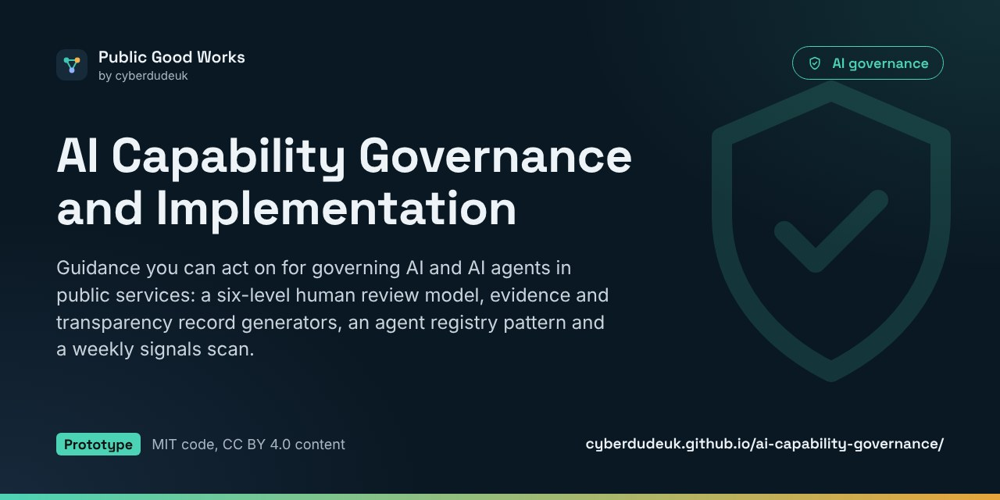</a> <a href="https://github.com/cyberdudeuk/ai-capability-governance">Repository</a> · Prototype · MIT code, CC BY 4.0 content</td><td width="50%" valign="top"><a href="https://cyberdudeuk.github.io/dcat-ap-uk/">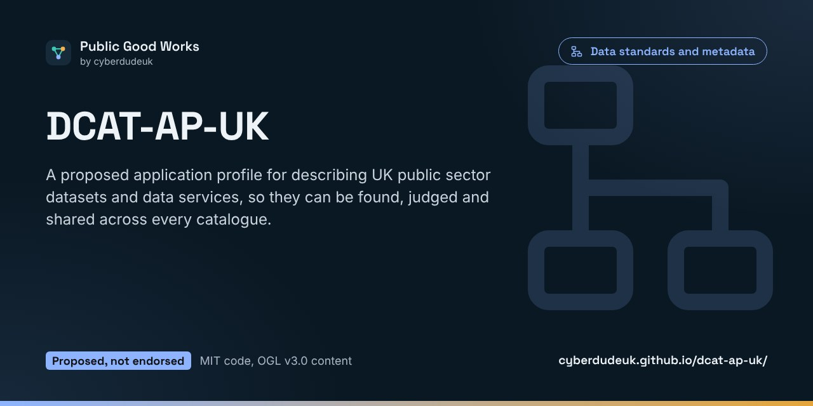</a> <a href="https://github.com/cyberdudeuk/dcat-ap-uk">Repository</a> · Proposed, not endorsed · MIT code, OGL v3.0 content</td></tr>
<tr><td width="50%" valign="top"><a href="https://cyberdudeuk.github.io/dam-capability-playbooks/">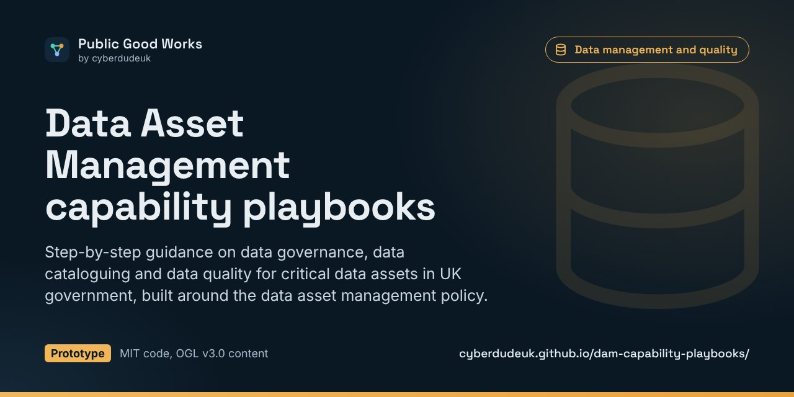</a> <a href="https://github.com/cyberdudeuk/dam-capability-playbooks">Repository</a> · Prototype · MIT code, OGL v3.0 content</td><td width="50%" valign="top"><a href="https://cyberdudeuk.github.io/dam-policy-explorer/"><strong>DAM Policy Explorer</strong></a> A one-stop shop for the UK government Data Asset Management Policy, made for DAM Policy coordinators and usable by anyone: the policy in plain English, questions and answers, and the return step by step. <a href="https://github.com/cyberdudeuk/dam-policy-explorer">Repository</a> · Prototype: in development · MIT code, OGL v3.0 content</td></tr>
<tr><td width="50%" valign="top"><a href="https://cyberdudeuk.github.io/dq-commons/">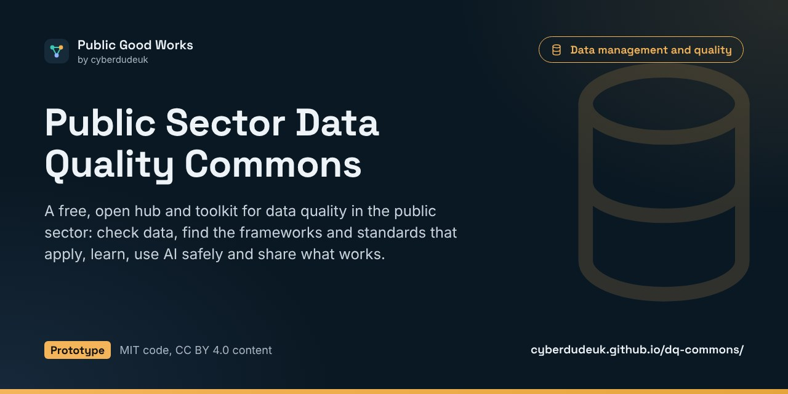</a> <a href="https://github.com/cyberdudeuk/dq-commons">Repository</a> · Prototype · MIT code, CC BY 4.0 content</td><td width="50%" valign="top"><a href="https://cyberdudeuk.github.io/opengovernment-uk/">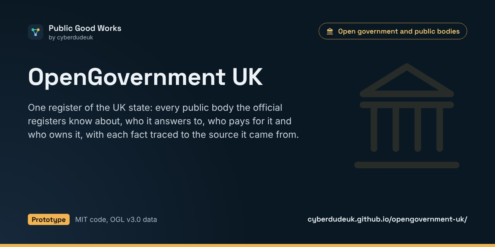</a> <a href="https://github.com/cyberdudeuk/opengovernment-uk">Repository</a> · Prototype: pilot, version 0.3.0 · MIT code, OGL v3.0 data</td></tr>
<tr><td width="50%" valign="top"><a href="https://cyberdudeuk.github.io/github-repos-asset-catalogue/">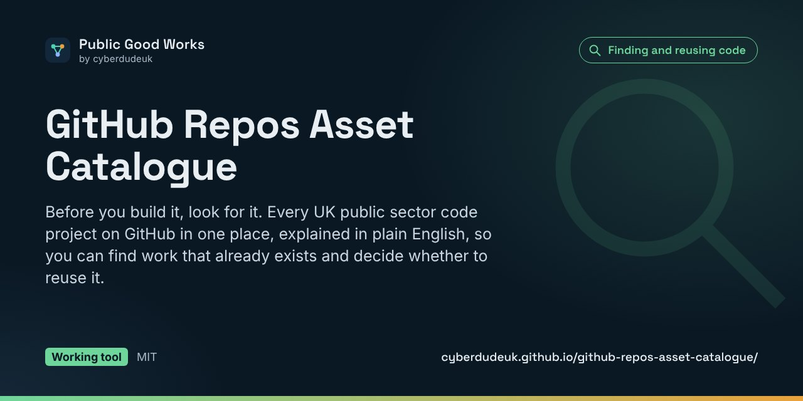</a> <a href="https://github.com/cyberdudeuk/github-repos-asset-catalogue">Repository</a> · Working tool · MIT code, CC BY 4.0 content</td><td width="50%" valign="top"><a href="https://cyberdudeuk.github.io/knowledge-web/dist/the-web.html">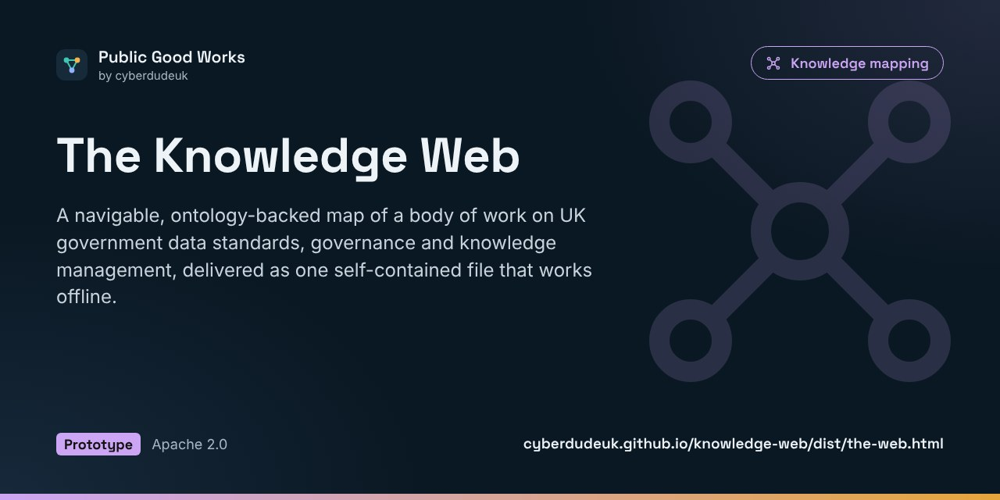</a> <a href="https://github.com/cyberdudeuk/knowledge-web">Repository</a> · Prototype · Apache 2.0</td></tr>
<tr><td width="50%" valign="top"><a href="https://cyberdudeuk.github.io/plainspoken/">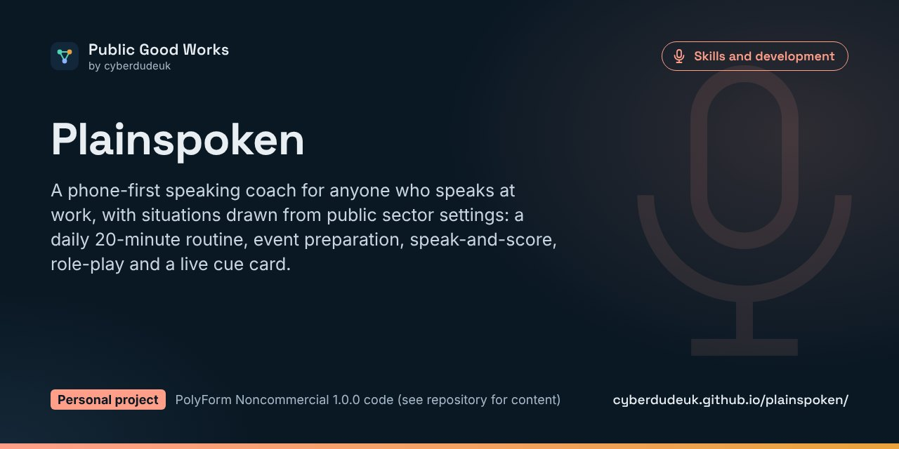</a> <a href="https://github.com/cyberdudeuk/plainspoken">Repository</a> · Personal project · PolyForm Noncommercial 1.0.0 code (see repository for content)</td><td width="50%" valign="top"><a href="https://cyberdudeuk.github.io/black-mixed-heritage/">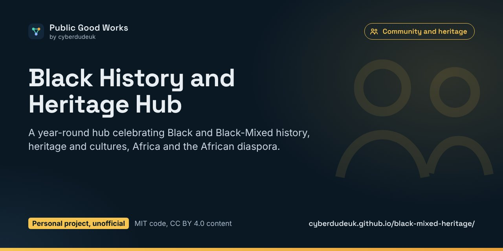</a> <a href="https://github.com/cyberdudeuk/black-mixed-heritage">Repository</a> · Personal project, unofficial (name provisional) · MIT code, CC BY 4.0 content</td></tr>
<tr><td width="50%" valign="top"><a href="https://cyberdudeuk.github.io/ndl-pubsec-mcp/">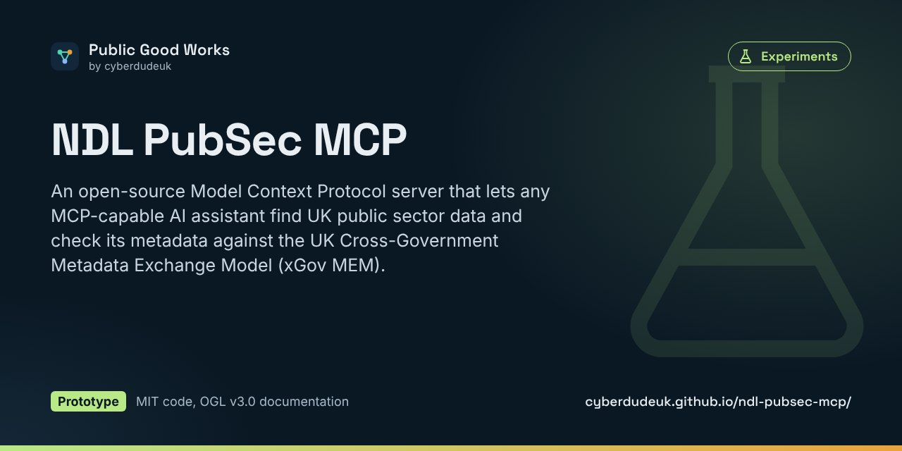</a> <a href="https://github.com/cyberdudeuk/ndl-pubsec-mcp">Repository</a> · Prototype: alpha, independent work · MIT code, CC BY 4.0 content</td><td width="50%" valign="top"><a href="https://cyberdudeuk.github.io/uk-youth-parliament-amplify/">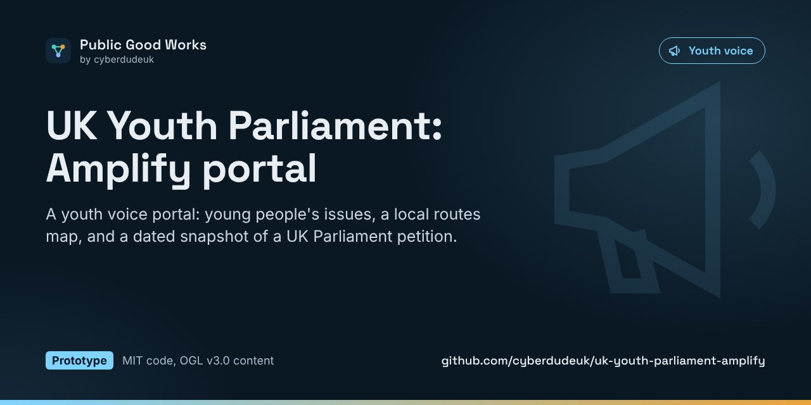</a> <a href="https://github.com/cyberdudeuk/uk-youth-parliament-amplify">Repository</a> · Prototype · MIT code, CC BY 4.0 content</td></tr>
</table>

## How every project is built

- **Checked before it ships.** Every repository runs its own checks on each pull request, plus CodeQL and OpenSSF Scorecard.
- **Accessible by default.** Pages are tested with axe-core at several widths, work by keyboard and respect reduced motion.
- **Honest about status.** Each project says plainly whether it is a prototype, proposed or a working tool, and what it is not.
- **Open by default.** Code under open licences; content under the Open Government Licence or Creative Commons where stated.
- **Contact by form only.** No email addresses are published: use the [contact form](https://github.com/cyberdudeuk/cyberdudeuk.github.io/issues/new?template=contact.yml).

## Recognition and open contributions

- **Permanent identifier:** [`w3id.org/dcat-ap-uk`](https://w3id.org/dcat-ap-uk), registered through a merged pull request to
  [perma-id/w3id.org#7100](https://github.com/perma-id/w3id.org/pull/7100).
- **Standards contributions:** issues and pull requests to the
  [UK Cross-Government Metadata Exchange Model](https://github.com/co-cddo/ukgov-metadata-exchange-model) and the
  [Data Standards Authority](https://github.com/alphagov/data-standards-authority) repositories.

<strong>Disclaimer, disclosures and transparency</strong>

- These are prototypes and personal public-good projects unless a project says otherwise. Nothing here is official
  government guidance or policy, and no project is endorsed by any department unless it says so.
- Some project text and code were drafted with AI assistance and then checked; each repository says how it is checked.
- Figures and claims link to their sources inside each project. If something is wrong, use the [contact form](https://github.com/cyberdudeuk/cyberdudeuk.github.io/issues/new?template=contact.yml).

&nbsp;&nbsp; 
Public Good Works · https://cyberdudeuk.github.io/ · last change 2026-11-20 · register v1.4.0

